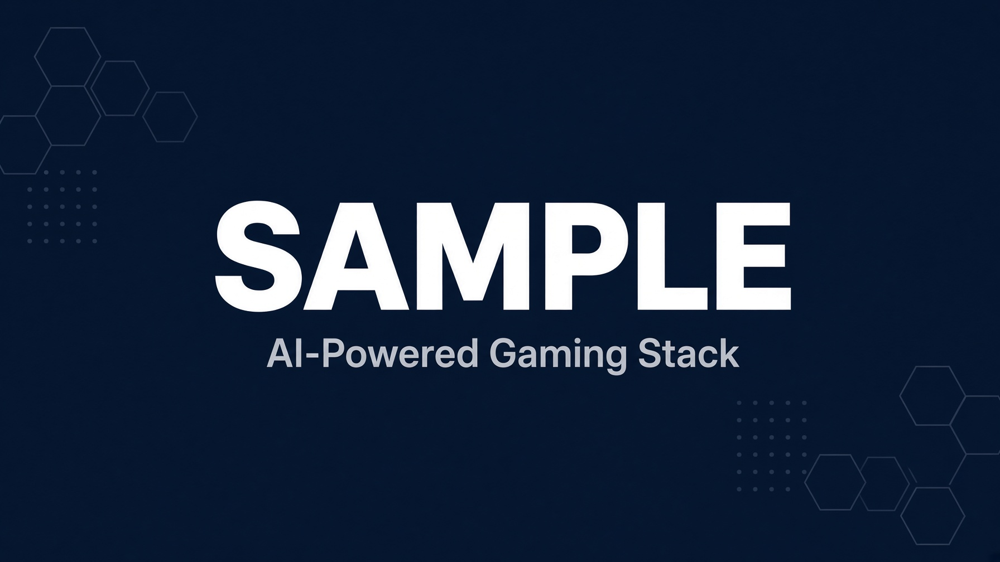
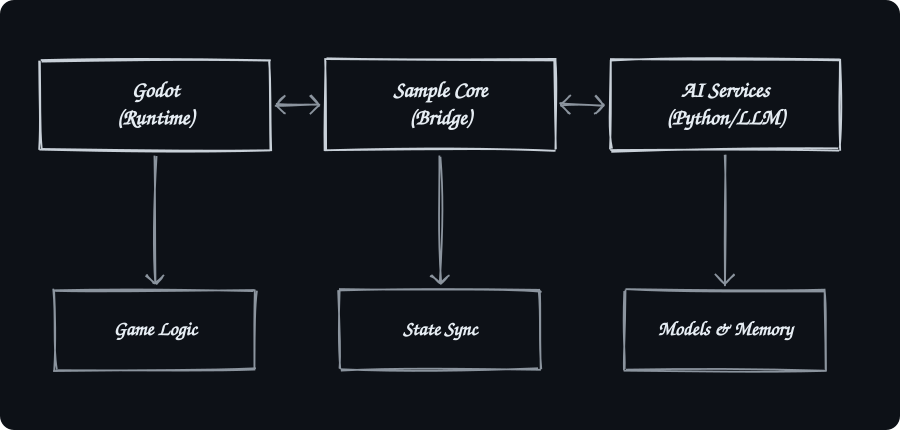

  

<h1 align="center">Sample</h1>

  <strong>AI-Powered Gaming Stack</strong>

  Build intelligent, adaptive games with generative AI, procedural content, and living NPCs.
   
  From prototype to production — in one modern stack.

  

  <a href="#features">Features</a> •
  <a href="#tech-stack">Tech Stack</a> •
  <a href="#roadmap">Roadmap</a> •
  <a href="#contributing">Contributing</a>

---

## About

**Sample** is a modern, open-source gaming stack designed for developers who want to ship games with real intelligence baked in.

Instead of bolting AI on as an afterthought, Sample treats generative AI, procedural generation, and adaptive systems as first-class citizens. Whether you're building a narrative RPG, a roguelike, a multiplayer experience, or an experimental title, Sample gives you the tools to create worlds and characters that feel alive.

> Built for game developers who care about both craft and cutting-edge technology.

---

## Features

| Feature | Description |
|---------|-------------|
| **AI NPCs** | Context-aware characters powered by local or cloud LLMs. Personality, memory, and goals out of the box. |
| **Procedural Worlds** | Generate levels, quests, and environments that adapt to player behavior. |
| **Adaptive Difficulty** | Real-time systems that learn from player skill and adjust the experience. |
| **Narrative Engine** | Dynamic storytelling that responds to player choices without railroading. |
| **Multiplayer Ready** | Built-in networking with AI-assisted matchmaking and spectator modes. |
| **Editor Tools** | Visual tools to design AI behaviors, train models, and preview generation. |
| **Cross-Platform** | Deploy to desktop, web, and mobile from a single codebase. |
| **Modular** | Use the full stack or pick only the modules you need. |

---

## Tech Stack

- **Engine**: Godot 4.x (primary) + optional Unity export pipeline
- **AI Runtime**: Python 3.11+ (FastAPI services) + ONNX / llama.cpp for local inference
- **Language**: GDScript + TypeScript (tooling) + Python (AI layer)
- **Networking**: WebRTC + WebSockets
- **Data**: SQLite (local) / PostgreSQL (cloud)
- **Build**: Docker + GitHub Actions
- **Editor**: VS Code / Cursor with dedicated extensions

---

## Architecture

  

- **Runtime**: Godot handles rendering, physics, and input.
- **Bridge**: Lightweight layer that syncs game state with AI services.
- **AI Services**: Separate processes (local or remote) that handle inference, memory, and generation.

---

## Roadmap

- [x] Core AI NPC system
- [x] Procedural dungeon generator
- [x] Local LLM support (llama.cpp)
- [ ] Visual behavior tree editor
- [ ] Multiplayer AI director
- [ ] Asset generation pipeline (textures, audio, animations)
- [ ] Unity & Unreal exporters
- [ ] Cloud dashboard for model training

---

## Contributing

We welcome contributions of all kinds — code, documentation, examples, and ideas.

1. Fork the repository
2. Create a feature branch (`git checkout -b feature/amazing-feature`)
3. Commit your changes
4. Open a Pull Request

---

## License

Distributed under the **MIT License**.

---

## Acknowledgments

- Inspired by the best practices from [awesome-readme](https://github.com/matiassingers/awesome-readme)
- Built with love by the open-source game development community
- Special thanks to the Godot and Hugging Face teams

---

  Made with care for game developers who want more than static content.
   
  <a href="https://github.com/hypr-ego/sample">GitHub</a>

